<div align="center">


# Yumi

**VPN-клиент для Android на ядре Xray, который чинится сам.**

Подписки, серверы по ссылке или QR-коду, свои DNS-резолверы, телевизор с пультом на телефоне —<br>в Material 3 Expressive, и с туннелем, который уходит с упавшего сервера, пока вы не смотрите.

<br>

[](https://github.com/GXUser7/yumi/releases/latest)
[](https://github.com/GXUser7/yumi/releases)
[](#установка)
[](https://github.com/XTLS/Xray-core)
[](#сборка-из-исходников)
[](#лицензия)
[](https://t.me/MaterialYouCloud)

<br>

### [Скачать последнюю версию](https://github.com/GXUser7/yumi/releases/latest)

[Возможности](#возможности) &nbsp;·&nbsp; [Телевизор](#на-телевизоре) &nbsp;·&nbsp; [Приватность](#приватность) &nbsp;·&nbsp; [Установка](#установка) &nbsp;·&nbsp; [Сборка](#сборка-из-исходников) &nbsp;·&nbsp; [English](README.en.md)

<br>

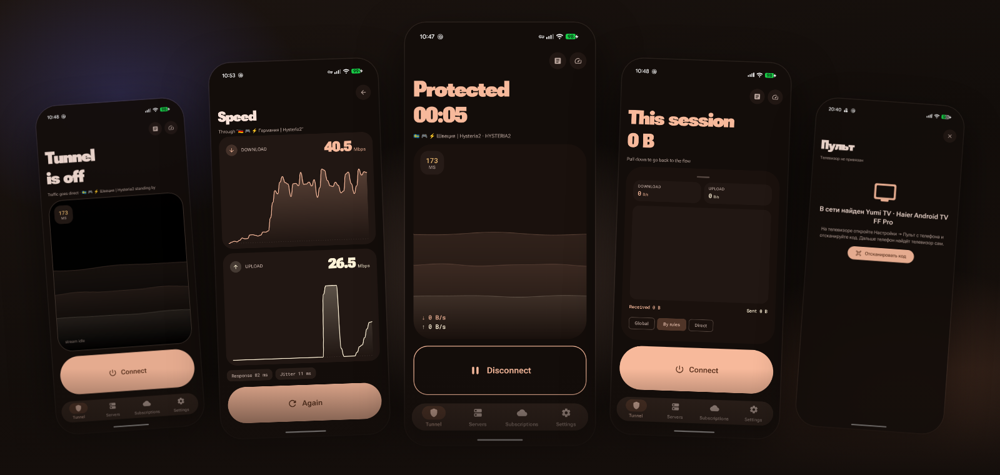

</div>

<br>

## Почему Yumi

<table>
  <tr>
    <td width="33%" valign="top">
      <h3>Чинится сам</h3>
      Раз в двадцать секунд проверяет, что через туннель правда идут данные, и уходит с упавшего сервера на живой. А потом говорит, что починил.
    </td>
    <td width="33%" valign="top">
      <h3>Почти любая подписка</h3>
      VLESS, VMess, Trojan, Shadowsocks, Hysteria2, WireGuard; REALITY и XHTTP; подписки ссылками, Clash YAML, Xray JSON и SIP008.
    </td>
    <td width="33%" valign="top">
      <h3>Ничего лишнего наружу</h3>
      Без статистики и аналитики. Серверы и ключи не уходят даже в бэкап Google, а идентификатор устройства для панелей — случайный.
    </td>
  </tr>
</table>

<br>

## Возможности

<table>
  <tr>
    <td width="62%" valign="middle">

### Подключение

- **Одна кнопка** — и туннель на ядре [Xray](https://github.com/XTLS/Xray-core) поднят.
- **Смена сервера на живом туннеле не рвёт соединение:** серверы живут в конфиге группой, переезд — переключение указателя внутри ядра. Кэш DNS и открытые соединения остаются, счётчики и таймер сессии не сбрасываются.
- **Маршрутизация:** всё через туннель, всё напрямую или по правилам — российские сайты и адреса идут мимо VPN.
- **Плитка в шторке**, автозапуск при загрузке и поддержка «Постоянного VPN».

</td>
    <td width="38%" align="center">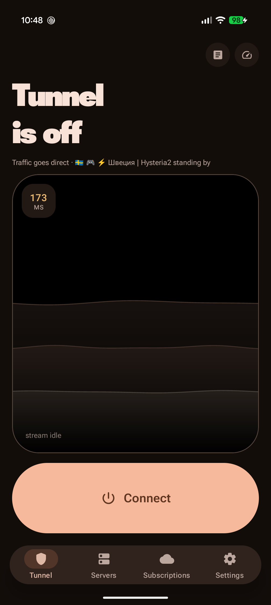</td>
  </tr>
</table>

<table>
  <tr>
    <td width="38%" align="center">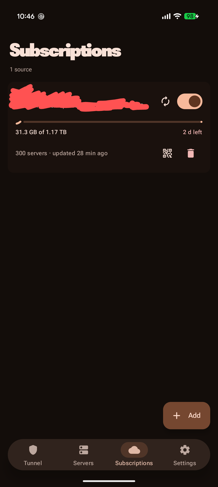</td>
    <td width="62%" valign="middle">

### Серверы и подписки

- **Добавить можно почти что угодно:** `vless://`, `vmess://`, `trojan://`, `ss://`, `hysteria2://`, `wireguard://`, `socks://`, `http://` — вставкой или QR-кодом; всё, кроме `http://`, ловится и нажатием на ссылку в другом приложении.
- **Подписки в любом формате панелей:** список ссылок (base64 или текстом), **Clash YAML**, **Xray/v2ray JSON**, **SIP008**. Можно сказать, что вы вставляете, — или доверить распознавание приложению.
- **Транспорты:** TCP/RAW, WebSocket, gRPC, HTTPUpgrade, **XHTTP** (splithttp), mKCP, QUIC — с TLS, REALITY, Vision и подменой отпечатка браузера (uTLS).
- **Честно о том, чего ядро не умеет:** TUIC, AnyTLS, ShadowTLS, Hysteria первой версии, SSH и подписки sing-box JSON отсеиваются при добавлении и пишутся в журнал, а не стоят в списке, молча не работая.

</td>
  </tr>
</table>

<table>
  <tr>
    <td width="62%" valign="middle">

### Чинится сам

- **Проверка сквозь туннель:** раз в двадцать секунд приложение тянет через него страницу — сервер умеет отвечать на порт и при этом не пропускать ни байта. Две неудачи подряд, вторая через три секунды, — и туннель переезжает на живой сервер из списка подмены, который вы выбираете сами.
- **Не винит сервер за чужие грехи:** без интернета (лифт, метро) проверки встают на паузу, при смене сети старые соединения закрываются сразу, а если не ответил никто — приложение остаётся на месте.
- **Свои серверы для мобильного интернета:** на сотовой сети туннель переезжает на них и остаётся в их пределах, на Wi-Fi возвращается к обычному списку.
- **Запасной DNS:** если перестал отвечать ваш резолвер, приложение переходит на `1.1.1.1` до следующего переподключения и говорит об этом.
- **Уведомления о том, что чинилось само** — замена сервера, замена DNS, опустевший список, новая версия; четыре отдельных переключателя.

</td>
    <td width="38%" align="center">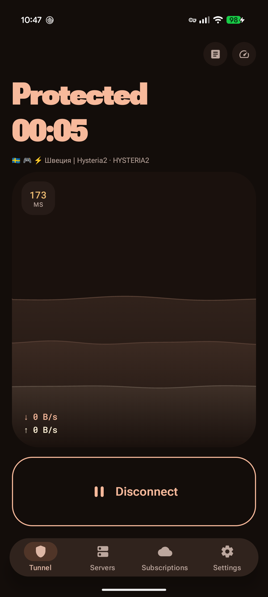</td>
  </tr>
</table>

<details>
<summary><b>Подробнее: почему именно так</b></summary>

<br>

**Почему проверка тянет данные, а не пингует порт.** Сервер может отвечать на порт и при этом не
пропускать ни байта. Такой сервер выглядит живым снаружи, и только запрос насквозь показывает, что
трафик не идёт.

**Почему сотовая, а не платная сеть.** Признак «платная» описывает тариф, а не сеть: временно
безлимитный 5G и домашний Wi-Fi с ограничением трафика сюда не попадают. Переезд ждёт, пока сеть
устоится, — четыре секунды на сотовую, двенадцать на возвращение, — потому что на краю покрытия
телефон мигает между сетями ровно столько, сколько человек там стоит. При выключенном экране переезд
откладывается: часть прошивок гасит Wi-Fi вместе с экраном и уходит на сотовую.

**Почему запасной DNS.** Мёртвый резолвер — единственная поломка, которую не лечит смена сервера, и
самая незаметная: перестают открываться сразу все сайты, хотя туннель исправно пропускает трафик.
Поэтому у проверки есть вторая половина, которая резолвит имя через ваш собственный DNS.

**Почему уведомления.** Вся ценность автоматического ухода с упавшего сервера в том, что в этот
момент никто не смотрит на экран — поэтому никто и не узнаёт, что уход был.

</details>

<table>
  <tr>
    <td width="38%" align="center">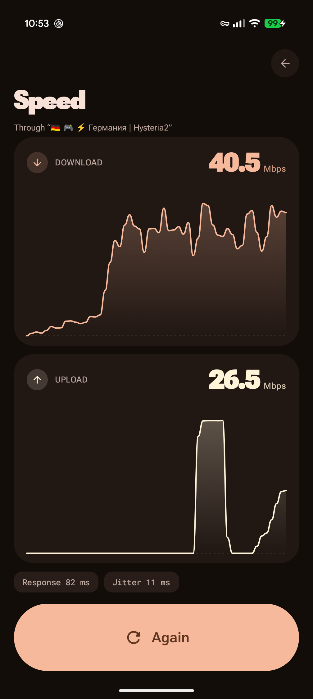</td>
    <td width="62%" valign="middle">

### Задержка и скорость

- **Задержка тремя способами:** рукопожатие TCP, полное рукопожатие TLS (для REALITY это разница между «порт открыт» и «маскировка работает») и медиана из трёх проб; QUIC-узлы проверяются UDP-пробой.
- **Скорость — через выбранный сервер,** а не мимо туннеля: приём, отдача, отклик и разброс со стрелочным прибором и живым графиком.
- **Статистика сессии:** сколько пришло и ушло за подключение, режим маршрутизации под рукой.

</td>
  </tr>
</table>

### DNS и маршрутизация

- **DNS-резолверы — такие же объекты, как серверы:** добавляются ссылкой (DoH-адрес, `tcp://`, `udp://`, голый адрес или `sdns://`-штамп), хранятся списком и переключаются одним нажатием, в том числе на поднятом туннеле.
- **Без тихого понижения:** DNS-over-TLS и DNS-over-QUIC ядро не умеет, поэтому `tls://` и `quic://` отклоняются при добавлении, а не превращаются молча в обычный UDP.
- **«Напрямую» + свой DNS** — без VPN, но с нужным резолвером: трафик идёт с обычного адреса, имена разрешает выбранный сервис.
- **Базы маршрутизации** (`geoip.dat` и `geosite.dat`, около 24 МБ) скачиваются сами после первого подключения; в настройках видно, лежат ли они на диске, и есть кнопка обновить. Пока их нет, правила по странам в конфиг не попадают — и это видно, а не прячется.
- **Ещё:** обход локальной сети, блокировка рекламных доменов и раздельное туннелирование по приложениям.

### И ещё

- **Обновления из приложения:** магазина нет, поэтому проверка раз в двенадцать часов или по кнопке, скачивание и передача системному установщику.
- **Русский и английский** — по умолчанию язык системы, в настройках можно выбрать явно.
- **Тёмная тема с AMOLED-режимом** и палитра из обоев системы.
- **Журнал ядра** прямо в приложении.

<br>

## На телевизоре

Отдельное приложение для Android TV — файл **yumi-tv** в том же релизе. Управление с пульта,
подписка переезжает с телефона по QR-коду, семь готовых палитр, подписки обновляются сразу при запуске.

<table>
  <tr>
    <td width="50%">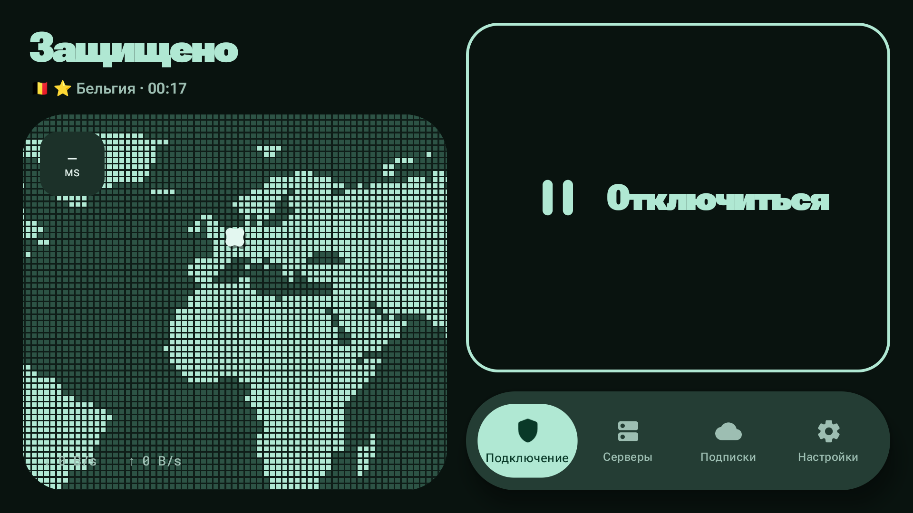</td>
    <td width="50%">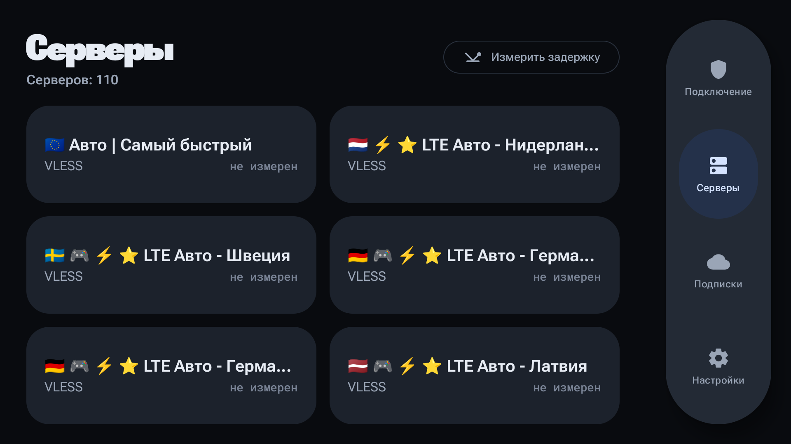</td>
  </tr>
  <tr>
    <td>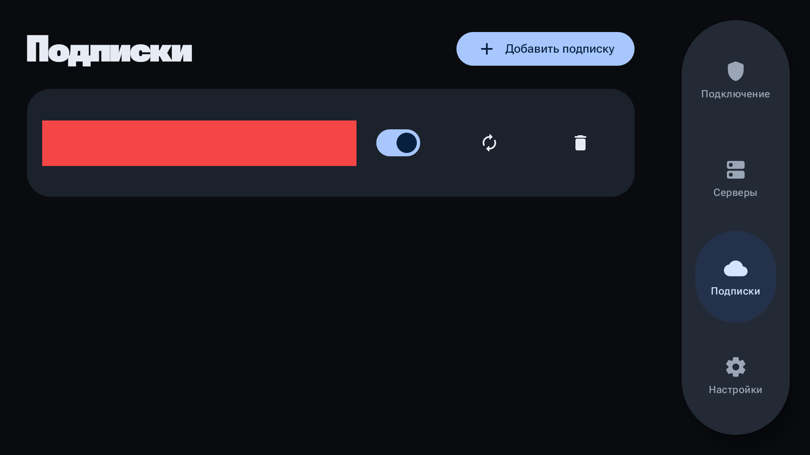</td>
    <td>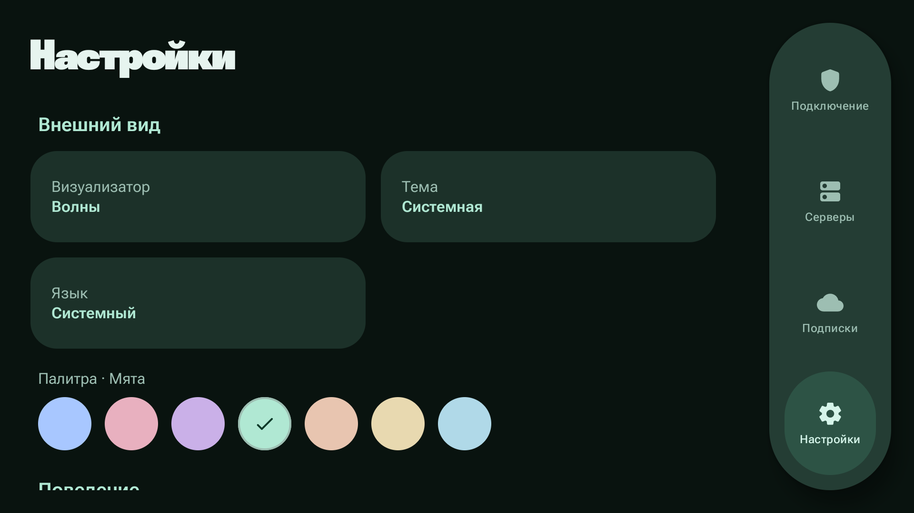</td>
  </tr>
</table>

### Телефон как пульт

Один раз отсканируйте код из «Настройки → Пульт с телефона» на телевизоре через «Подписки → Добавить →
Сканировать» на телефоне. Дальше телефон сам находит телевизор в сети, а на экране «Подключение»
появляется кнопка пульта: включить, выключить и переключить сервер, не вставая с дивана.

<p align="center">
  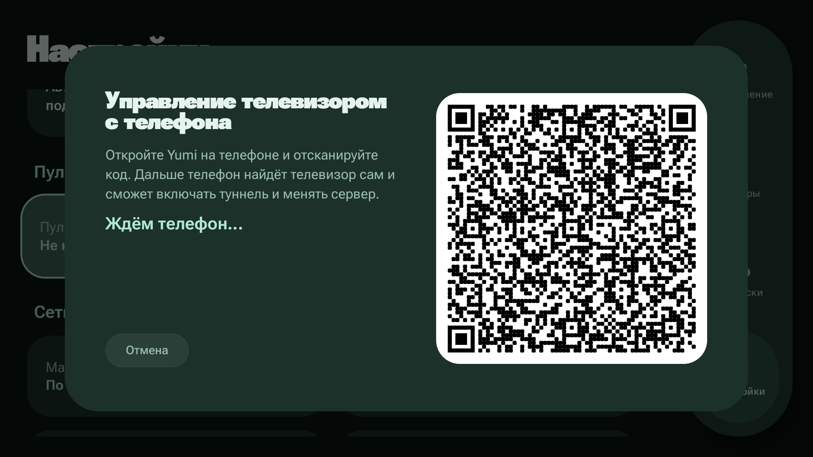
  &nbsp;
  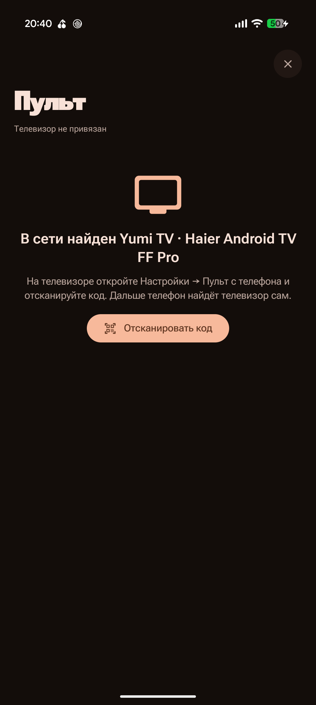
  &nbsp;
  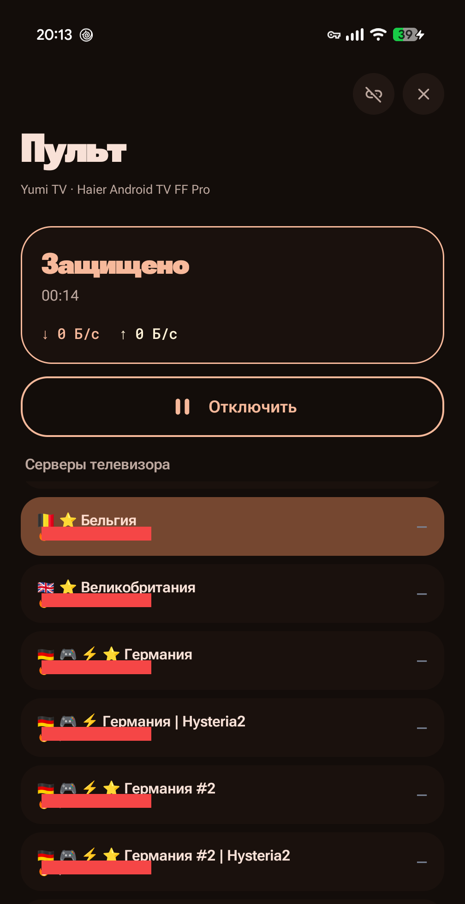
</p>

<br>

## Приватность

**Приложение не собирает статистику и никуда не отправляет данные о вас.** Серверы, подписки и ключи
лежат только на телефоне: резервное копирование Android для них выключено, поэтому в облако
Google они не уезжают ни через бэкап, ни при переносе на новый телефон.

Соединения, которые оно делает само: обновление ваших подписок, замер задержки до ваших серверов
и — если вы его запустите — замер скорости через `speed.cloudflare.com`. Все они идут мимо
туннеля: иначе замер измерял бы сам себя, а обновление подписки шло бы через сервер, который она
и раздаёт.

Одно исключение, и оно нужно там, где интернет отдают по белым спискам: если подписка не
открывается напрямую, приложение повторяет запрос через собственный туннель. Иначе обновить
её на такой сети нельзя вообще — приложение исключает себя из своего туннеля, и его запросы
упираются в ту же блокировку, что и всё остальное.

Панели с привязкой к устройству получают идентификатор `x-hwid`. Он **случайный и создаётся один
раз при установке**: настоящий идентификатор устройства стал бы меткой, по которой пользователя
узнаёт каждая панель, где он когда-либо подписывался.

<br>

## Установка

1. Скачайте `yumi-<версия>-arm64-v8a.apk` из [релизов](https://github.com/GXUser7/yumi/releases/latest).
   Почти всем нужен именно **arm64-v8a**; `armeabi-v7a` — только для очень старых телефонов.
   Для телевизора — `yumi-tv-<версия>-…apk`.
2. Откройте файл и разрешите установку из этого источника, если Android спросит.
3. При первом подключении система спросит разрешение на VPN — без него туннель не поднять.

Нужен Android 8.0 или новее. Обновления ставятся поверх, серверы и настройки сохраняются.

Есть и версия для Windows — [yumi-desktop](https://github.com/GXUser7/yumi-desktop) (бета).

<br>

## Сборка из исходников

```bash
export JAVA_HOME=~/.gradle/jdks/eclipse_adoptium-21-amd64-linux.2
./gradlew :app:assembleDebug          # телефон
./gradlew :tv:assembleDebug           # телевизор
./gradlew :shared:testDebugUnitTest   # тесты живут здесь, в :app и :tv их нет
```

**Ядра в репозитории нет.** Xray не публикует привязку для мобильных платформ, поэтому она живёт
здесь же — модуль `core-xray/`, из которого `gomobile bind` собирает `shared/libs/libyumi.aar`.
Файл больше лимита GitHub в 100 МБ, так что собрать его нужно самому и положить туда руками;
без него не компилируется ничего, включая тесты. Команда сборки и всё остальное, что стоит знать
о внутренностях, — в [DEVELOPMENT.md](DEVELOPMENT.md): почему стек TUN именно gvisor, как ловятся
отказы ядра, откуда берутся гео-правила и чем это всё проверяется без устройства.

<br>

## Благодарности

Ядро — [Xray-core](https://github.com/XTLS/Xray-core) от XTLS. Базы маршрутизации — из
репозиториев [v2fly/geoip](https://github.com/v2fly/geoip) и
[v2fly/domain-list-community](https://github.com/v2fly/domain-list-community).

## Лицензия

[GNU GPL v3 или новее](LICENSE). Copyright © 2026 GXUser7.

<details>
<summary>Почему GPL</summary>

<br>

Выбор здесь по-прежнему не свободный, хотя причина сменилась вместе с ядром. Сам Xray-core под
MPL-2.0, и её одной хватило бы на любую лицензию. Но реализация Shadowsocks-2022 внутри Xray
построена на библиотеке [`sagernet/sing`](https://github.com/SagerNet/sing), а та под GPLv3 или
новее, — и `libyumi.aar` линкует её вместе со всем остальным прямо в приложение. Значит, и
приложение целиком обязано быть под GPLv3.

На практике это значит, что всякий, кто раздаёт собранный APK, обязан отдать вместе с ним и
исходники под той же лицензией.

</details>

---

<sub>Yumi подключается только к серверам из ваших подписок и сам по себе доступа в интернет не даёт.</sub>
