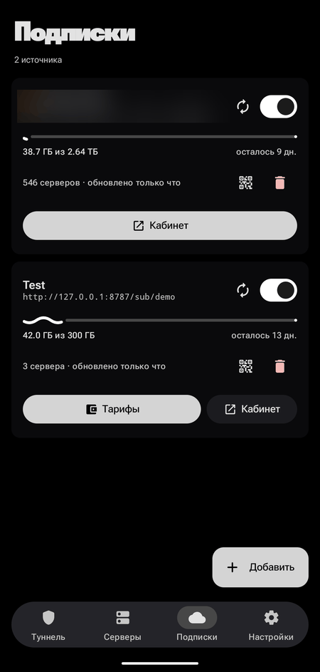

# Open Subscription Billing (OSB) — Спецификация v0.1

> [!NOTE]
> Открытый протокол для VPN-панелей (Remnawave, 3x-ui, Marzban), ботов-магазинов (Remnashop, Bedolaga и кастомных ЛК) и Xray/sing-box/Clash-клиентов. Позволяет показывать тарифы, доп. опции и оплату прямо в клиенте, не встраивая платёжные шлюзы в ядро самой прокси-панели.

---

## 1. Обзор и не-цели (Scope / Non-Goals)

**Зачем это нужно:** существующие заголовки (`profile-web-page-url`, `sub-expire-button-link`) лишь перекидывают пользователя на общую веб-страницу без структурированных данных о тарифах, промокодах и методах оплаты. Самая частая тупиковая ситуация на практике — **когда подписка уже истекла или упёрлась в лимит трафика/HWID: без активного VPN у многих пользователей просто не открывается Telegram, где живут боты-магазины**, и продлить доступ не получается.

Передача `billing-manifest-url` / `payment-url` в заголовках ответа подписки позволяет клиенту сразу показать тарифы и открыть прямую веб-страницу оплаты (СБП / карта / платёжный шлюз на доступном домене) в 1–2 касания без захода в Telegram. Дополнительно флаг `routing_hint: "direct"` помогает при продлении уже активной подписки в глобальном режиме VPN, чтобы банковские шлюзы не отклоняли платёж с зарубежного IP.



**Не-цели:**
- Спецификация **не требует** хранить тарифы, цены и эквайринг внутри ядра прокси-панели (например, в `remnawave/backend`). Панель лишь отдаёт URL на внешний биллинг-манифест через Response Headers / Response Rules.
- Спецификация **не допускает** передачу списка тарифов в HTTP-заголовках (из-за жёстких лимитов буфера заголовков прокси/nginx, проблем с локализацией и невозможности динамически создавать счёт).
- Спецификация **не обязывает** клиенты из App Store / Google Play рисовать цены внутри приложения (см. раздел 6).

---

## 2. Обнаружение (Discovery — Уровни 0, 1 и 2)

При каждом `GET`-запросе ссылки подписки сервер может возвращать следующие HTTP-заголовки (регистронезависимо):

| Уровень | Заголовок | Назначение |
| --- | --- | --- |
| Level 2 | `billing-manifest-url` | HTTPS URL на JSON-манифест тарифов, доп. опций и endpoint оплаты |
| Level 1 | `payment-url` | Прямая HTTPS-ссылка на оплату/продление без витрины тарифов |
| Compat | `sub-expire-button-link` | Существующий заголовок формата Happ (кнопка продления при истечении) |
| Level 0 | `profile-web-page-url` | Веб-кабинет/портал пользователя (существующий де-факто стандарт) |
| Aux | `support-url` | Ссылка для связи с поддержкой |

### Приоритет на клиенте
1. Если клиент поддерживает полную витрину и есть валидный `billing-manifest-url` -> открывать нативный экран тарифов (**Уровень 2**).
2. Иначе, если есть `payment-url` (или `sub-expire-button-link` при истечении/ошибке) -> кнопка быстрого перехода к оплате с проверкой домена (**Уровень 1**).
3. Иначе, если есть `profile-web-page-url` -> кнопка «Личный кабинет» (**Уровень 0**).

### Фолбэк в теле подписки (для статики)
Если бэкенд не может управлять HTTP-заголовками (например, статический файл), клиент МОЖЕТ читать комментарии с префиксом `#` или `//` в первых 10 строках ответа:
```text
#billing-manifest-url: https://shop.provider.tld/api/sub-billing/k8xN9qLp
#payment-url: https://pay.provider.tld/quick/k8xN9qLp
```
**Правило приоритета:** реальные HTTP-заголовки ответа **всегда** перекрывают `#`-комментарии в теле.

### Обязательное правило при отказах (Expired / HWID Limit)
Если подписка истекла, исчерпала трафик или достигла лимита устройств (`x-hwid-max-devices-reached`), панель часто возвращает список заглушек (`0.0.0.0:1`) с текстом ошибки вместо реальных серверов. Клиент **обязан** извлечь и сохранить `billing-manifest-url`, `payment-url`, `sub-expire-button-link`, `profile-web-page-url` и `support-url` даже при таком отказе, чтобы показать кнопку продления или докупки/сброса устройств вместо тупика.

---

## 3. Контракт `GET billing-manifest-url` (Schema v1)

Клиент запрашивает манифест **лениво** (при нажатии пользователем на «Тарифы» / «Продлить», либо с уважением `Cache-Control`), чтобы не создавать лишнюю нагрузку при фоновых обновлениях серверов.

### Заголовки запроса клиента
- `Accept: application/json`
- `Accept-Language`: локаль устройства (например, `ru-RU,ru;q=0.9,en;q=0.8`)
- `User-Agent`: агент клиента (например, `Yumi/2.3.1 (Android)`)
- **Строго ЗАПРЕЩЕНО:** передавать `x-hwid`, `x-device-os`, `x-ver-os`, `x-device-model` и `Authorization` от подписки, если origin `billing-manifest-url` отличается от origin самой подписки.

### Формат ответа (`200 OK`, `Content-Type: application/json`)

Все денежные значения (`price`, `old_price`, `amount`) передаются **целыми числами в минимальных единицах валюты** (копейки для `RUB`, центы для `USD`/`EUR`, целые звёзды для `XTR`, минимальные единицы для `USDT` согласно `currency_decimals`, по умолчанию `2` для фиата и `0` для `XTR`). Это исключает ошибки округления `float`.

```json
{
  "version": 1,
  "provider": {
    "name": "Example VPN",
    "support_url": "https://t.me/example_vpn_support"
  },
  "account": {
    "status": "ACTIVE",
    "current_plan": "Про",
    "expires_at": "2026-12-06T23:59:59Z",
    "devices_used": 2,
    "device_limit": 3
  },
  "routing_hint": "direct",
  "promo_supported": true,
  "fallback_web_url": "https://cabinet.example.com/u/k8xN9qLp",
  "payment_methods": [
    { "id": "sbp", "title": "СБП (без комиссии)", "type": "sbp" },
    { "id": "card", "title": "Карта РФ (Мир / Visa / MC)", "type": "card" },
    { "id": "crypto", "title": "USDT / TON", "type": "crypto" },
    { "id": "stars", "title": "Telegram Stars", "type": "tg_stars" }
  ],
  "plans": [
    {
      "id": "1m",
      "title": "1 месяц",
      "badge": null,
      "price": 24900,
      "old_price": null,
      "currency": "RUB",
      "duration_days": 30,
      "traffic_gb": 1024,
      "devices": 3,
      "features": ["Все локации", "1 ТБ трафика", "До 3 устройств"]
    },
    {
      "id": "1y",
      "title": "1 год",
      "badge": "Хит · -37%",
      "price": 189000,
      "old_price": 298800,
      "currency": "RUB",
      "duration_days": 365,
      "traffic_gb": 0,
      "devices": 5,
      "features": ["Безлимитный трафик", "До 5 устройств + Android TV"]
    }
  ],
  "addons": [
    {
      "id": "gb100",
      "title": "+100 ГБ трафика",
      "description": "Разовый пакет до следующего сброса счётчика",
      "price": 14900,
      "currency": "RUB"
    },
    {
      "id": "hwid1",
      "title": "+1 устройство (HWID)",
      "description": "Добавляет слот до конца текущего срока",
      "price": 9900,
      "currency": "RUB"
    }
  ],
  "checkout": {
    "endpoint": "https://shop.example.com/api/sub-billing/k8xN9qLp/checkout",
    "method": "POST"
  }
}
```

### Основные поля
- `version`: `1` (целое число; клиенты игнорируют неизвестные поля для прямой совместимости).
- `account.status`: `"ACTIVE" | "EXPIRED" | "LIMITED" | "DISABLED"`.
- `routing_hint`: `"direct" | "proxy" | "auto"`. При `"direct"` клиент выполняет `GET`/`POST` биллинга в обход VPN, а перед открытием браузера ориентируется на режим маршрутизации.
- `traffic_gb`: `0` означает безлимитный трафик.
- `payment_methods[].type`: `"sbp" | "card" | "crypto" | "tg_stars" | "wallet" | "other"`.

---

## 4. Контракт `POST checkout`, открытие оплаты и авто-обновление

Когда пользователь выбрал тариф (`plan_id`) или доп. опцию (`addon_id`) и способ оплаты (`payment_method`), клиент отправляет запрос на `checkout.endpoint`:

### Запрос (`POST`, `Content-Type: application/json`)
```json
{
  "plan_id": "1y",
  "addon_id": null,
  "payment_method": "sbp",
  "promo_code": "YUMI10",
  "return_url": "mydrop://billing/return?sub_id=sub-1"
}
```
- Передаётся ровно один из `plan_id` или `addon_id` (второй — `null`).
- Клиент может (необязательно) передавать `promo_code`, если `promo_supported == true`.

### Ответ (`200 OK` / `201 Created`)
```json
{
  "order_id": "RW-8492",
  "amount": 170100,
  "currency": "RUB",
  "payment_url": "https://pay.example.com/sbp/RW-8492",
  "routing_hint": "direct",
  "expires_at": "2026-11-23T13:20:00Z"
}
```

### Обработка ошибок (`4xx`)
Сервер возвращает JSON вида `{ "error": "<code>", "message": "<локализованный текст>" }`:
- `invalid_promo` (`400`) — промокод недействителен или истёк;
- `plan_not_found` (`404`) — тариф снят с продажи (клиенту стоит перечитать манифест);
- `rate_limited` (`429`) — слишком много попыток создания счёта.

### Открытие оплаты и возврат в клиент
1. **Запрет встроенного WebView:** платёжные страницы ДОЛЖНЫ открываться в системных Chrome Custom Tabs / ASWebAuthenticationSession / системном браузере — там работают приложения банков, СБП-интенты, 3DS и менеджеры паролей.
2. **Маршрут для платежа (`routing_hint: "direct"`):** российские платёжные шлюзы и банки часто блокируют оплату с зарубежных VPN-IP. В режиме маршрутизации «По правилам» домены `.ru` идут напрямую автоматически; если в клиенте включён режим «Глобально», клиент перед переходом предупреждает пользователя и предлагает временно поставить туннель на паузу.
3. **Возврат и обновление подписки:** при возврате по `return_url` (`mydrop://billing/return?sub_id=...` или `yumi://billing/return?sub_id=...`) или возвращении фокуса в окно приложения после запуска оплаты клиент делает до 3 попыток обновления подписки с возрастающей паузой (`1.5 с -> 3 с -> 5 с`), чтобы дождаться обработки вебхука на стороне панели.

---

## 5. Security & Privacy Guidelines (обязательно к выполнению)

1. **Строго `https://`:** клиент ОБЯЗАН отклонять любые URL в `billing-manifest-url`, `payment-url`, `sub-expire-button-link`, `checkout.endpoint` и `payment_url`, если их схема не `https` (никаких `http://`, `javascript:`, `file:`, `data:`), за исключением локальной отладки на loopback в debug-сборках.
2. **Изоляция секретов подписки (`sameOrigin`):** клиент НИКОГДА не отправляет `x-hwid`, `x-device-*`, пользовательские заголовки авторизации или саму ссылку подписки при запросах к домену биллинга.
3. **Отображение домена оплаты:** перед переходом по `payment_url` клиент показывает пользователю подтверждённый `https://` хост платёжной страницы.
4. **Минимальные права биллинг-токена:** токен в `billing-manifest-url` должен давать доступ только к чтению каталога, статусу подписки и созданию счёта (запрещены удаление аккаунта, экспорт секретных ключей или списание средств без явного шага на платёжном шлюзе).
5. **Защита бэкенда (Open Redirect и SSRF):**
   - Сервер шопа ОБЯЗАН валидировать `return_url` по строгому allowlist схем/префиксов (`mydrop://billing/`, `yumi://billing/`, `happ://`, `v2raytun://`, либо доверенные `https://` домены), отклоняя произвольные `javascript:` или фишинговые редиректы.
   - Сервер не должен проксировать произвольные URL, присланные клиентом.
6. **Защита от поддельных завышенных списков:** клиент ограничивает размер манифеста (`<= 512 КБ`) и число тарифов/аддонов (`<= 50`) и санитизирует строки без выполнения HTML/JS.

---

## 6. Store Compliance и Graceful Degradation

Клиенты, распространяемые через App Store или Google Play (Happ, v2RayTun и др.), подчиняются правилам площадок (включая Apple App Store Review Guideline 3.1.1 о внешних покупках).

Спецификация делит поведение на два режима:
- **Full Native Mode** (независимые релизы на GitHub, Android APK, Desktop): рендерит нативную витрину тарифов, аддонов, промокодов и методов оплаты из `billing-manifest-url`.
- **Store Safe-Mode** (сборки для App Store / Google Play): полностью игнорирует цены, промокоды и прайсы из манифеста, используя только `fallback_web_url` (или `profile-web-page-url`) как нейтральную кнопку «Управление аккаунтом / Веб-портал» — либо оставляет стандартное поведение стора.

---

## 7. Интеграция в Remnawave v3 и план PR

### Результаты аудита `remnawave/backend` (ветка `dev`, AGPL-3.0)
- **Глобальные заголовки (`settings.customResponseHeaders`) уже поддерживают шаблоны:** в `src/modules/subscription/subscription.service.ts` (`getUserProfileHeadersInfo`) каждое значение проходит через `TemplateEngine.replace(value, userValueMap)`, где уже доступны `{{SHORT_UUID}}`, `{{USERNAME}}`, `{{STATUS}}`, `{{TELEGRAM_ID}}`, `{{DAYS_LEFT}}`, `{{SS_HWID_LIMIT}}` и префикс `rwEncodeBase64:` — в том числе при ответах на лимит HWID и `respondWithRemarks`.
- **Найденный пробел в Response Rules (`responseModifications.headers`):** в `src/modules/subscription-response-rules/middleware/response-rules.middleware.ts` и `src/modules/subscription/controllers/subscription.controller.ts` заголовки конкретного правила (`headersToApply` / `res.setHeader`) отдаются **в сыром виде без `TemplateEngine`**, поэтому `{{SHORT_UUID}}` в правиле под конкретный `User-Agent` (например, чтобы отдавать `billing-manifest-url` независимым клиентам и оставлять Store-клиенты в безопасном режиме) пока не раскрывается.
- Официальная площадка для Feature Requests в Remnawave — `https://f.docs.rw/c/fr/7` (GitHub Discussions и пустые Issues в `remnawave/backend` отключены); Pull Request'ы принимаются в ветку **`dev`** с проверкой `npm run check` (`oxfmt --check && oxlint`) и `npm run build`.

### Готовое правило для админа Remnawave + внешнего шопа
```json
{
  "name": "OSB Billing Header",
  "description": "Передаёт ссылку на витрину тарифов совместимым клиентам",
  "enabled": true,
  "operator": "OR",
  "conditions": [
    { "headerName": "user-agent", "operator": "CONTAINS", "value": "Yumi", "caseSensitive": false },
    { "headerName": "user-agent", "operator": "CONTAINS", "value": "v2ray", "caseSensitive": false },
    { "headerName": "user-agent", "operator": "CONTAINS", "value": "Happ", "caseSensitive": false }
  ],
  "responseType": "XRAY_JSON",
  "responseModifications": {
    "headers": [
      { "key": "billing-manifest-url", "value": "https://shop.provider.tld/api/sub-billing/{{SHORT_UUID}}" },
      { "key": "payment-url", "value": "https://pay.provider.tld/quick/{{SHORT_UUID}}" },
      { "key": "profile-web-page-url", "value": "https://cabinet.provider.tld/{{SHORT_UUID}}" }
    ],
    "applyHeadersToEnd": true
  }
}
```

### План PR в Remnawave
1. **PR в `remnawave/backend` (ветка `dev`):** добавить резолв `TemplateEngine.replace(...)` (`{{SHORT_UUID}}`, `{{USERNAME}}`, `{{STATUS}}` и др.) для `responseModifications.headers` в Response Rules без встраивания тарифов или платёжных шлюзов в ядро панели.
2. **Feature Request в `https://f.docs.rw/c/fr/7` (и PR в документацию `docs.rw`):** описать стандарт `billing-manifest-url` / `payment-url` через Response Rules с безопасным деградированием в Store Safe-Mode.

### Шаблон Feature Request для `https://f.docs.rw/c/fr/7`
```markdown
### Proposal: Open Subscription Billing Headers (`billing-manifest-url`) + TemplateEngine Support in Response Rules Headers

**Problem**
Panels already expose `profile-web-page-url` and `support-url` in subscription responses, but those only open a generic dashboard. On mobile, when a VPN subscription expires or hits a traffic/HWID limit, users often cannot even open Telegram (where most VPN shop bots live) because their VPN tunnel is down, leaving them stuck with no way to renew.

**Why not build billing into Remnawave core?**
Remnawave cleanly separates proxy orchestration from retail billing, which belongs in external shops and bots. Rather than adding payment gateways to the panel, panels only need to pass a small standardized header (`billing-manifest-url` / `payment-url`) pointing to the external shop's JSON catalog and direct web checkout, plus an optional `routing_hint` for in-app / browser routing when the tunnel is active.

**What we found in `remnawave/backend` (`dev` branch)**
1. Global `customResponseHeaders` in `SubscriptionService.getUserProfileHeadersInfo` already runs `TemplateEngine.replace(...)` with `{{SHORT_UUID}}`, `{{USERNAME}}`, `{{STATUS}}`, etc.
2. However, per-rule `responseModifications.headers` in Response Rules (`ResponseRulesMiddleware` + `SubscriptionController.finalizeSubscriptionResponse`) does **not** pass through `TemplateEngine`, so `{{SHORT_UUID}}` stays literal when targeting specific client `User-Agent` rules (which is essential to enable rich billing headers for standalone clients while keeping App Store / Google Play builds in neutral web-portal mode).

**Proposed minimal change for Remnawave**
- Resolve `TemplateEngine` placeholders (`{{SHORT_UUID}}`, `{{USERNAME}}`, etc.) in `responseModifications.headers` when serving subscription responses (PR targeting `dev`, no billing logic in core).
- Document the `billing-manifest-url` / `payment-url` convention (and App Store / Google Play safe-mode rules) in `docs.rw`.

**Reference spec & working client demo (GIF)**
- Spec v0.1: https://github.com/GXUser7/yumi/blob/main/docs/open-subscription-billing.md
- Working Android client demo (sanitized GIF): https://raw.githubusercontent.com/GXUser7/yumi/main/docs/assets/open-subscription-billing-demo.gif
```
